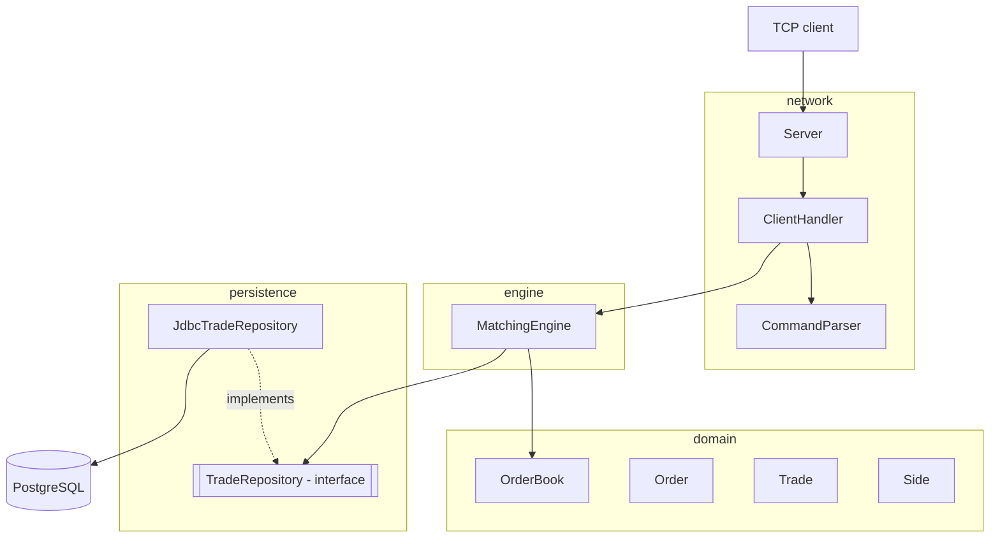

# MiniExchange — Architecture

## Goal
A small stock exchange: clients connect over TCP, send BUY / SELL / CANCEL orders,
the engine matches them by **price-time priority**, and trades are saved in PostgreSQL.

## Layers

| Package | Classes | Responsibility |
|---|---|---|
| `domain` | `Side`, `Order`, `Trade`, `OrderBook` | Business data and sorted order book |
| `engine` | `MatchingEngine` | Match incoming orders against the book, produce trades |
| `network` | `Server`, `ClientHandler`, `CommandParser` | Accept TCP clients, parse text commands, send replies |
| `persistence` | `TradeRepository`, `JdbcTradeRepository` | Save trades (interface + JDBC implementation) |

## Dependency rule
- `domain` depends on **nothing** (no sockets, no SQL) → testable with plain JUnit.
- `engine` depends on the `TradeRepository` **interface**, not on JDBC (DIP) → tests can use an in-memory fake.
- New entry points (REST API) or databases can be added without changing the matching logic (OCP).

## Matching rule: price-time priority
1. **Price:** best price first — highest bid, lowest ask.
2. **Time:** at the same price, the earliest order fills first.
3. **Trade price:** the price of the resting (already waiting) order.

## Design decisions
| Decision | Reason |
|---|---|
| Prices stored as `long` (cents), never `double` | `double` has rounding errors; money must be exact |
| Time priority uses a **sequence number**, not a timestamp | Two orders can share a millisecond; a counter never ties |
| No framework (no Spring) | Keep concurrency and JDBC code visible |
| Thread safety concentrated in the engine | One place to reason about correctness |

## Open decision (Day 7): thread safety
- **Option A — Locks:** client threads call the engine directly; a lock protects the order book.
- **Option B — Queue + single engine thread:** client threads put orders into a queue; one thread matches them in order (LMAX-style, no locks).
